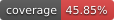
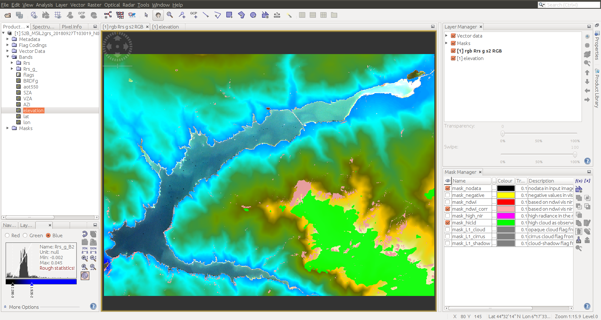
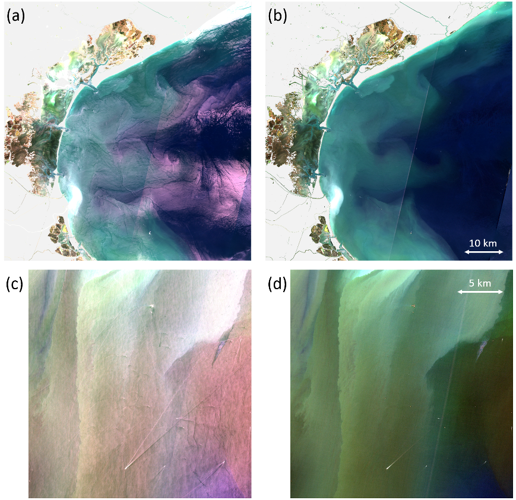

# GRS algorithm package
[](https://www.python.org/)
[](https://opensource.org/license/Apache-2.0)
[](https://github.com/CNES/GRSprocessor/actions)
[]()
[](https://hub.docker.com/r/guillaumeeb/grs)
[](https://pypi.org/project/GRSprocessor/)

## GRS (Glint Removal for Sentinel-2-like sensors)

The GRS algorithm ([Harmel et al.,
2018](https://www.sciencedirect.com/science/article/pii/S0034425717304856))
corrects high-spatial resolution multispectral images (Sentinel-2,
Landsat 8/9) acquired over water for the atmosphere and for the sunlight
reflected by the water surface (sunglint), which can reach the sensor of
nadir or near-nadir viewing missions with SWIR bands. The processor
corrects successively for:

-   the gaseous absorption,
-   the diffuse light of the sky and its reflection by the air-water
    interface,
-   the sunglint, estimated in the SWIR bands,

to retrieve the remote-sensing reflectance $R_{rs}$ at the water
surface.

``` bash
grs S2B_MSIL1C_20220731T103629_N0400_R008_T31TFJ_20220731T124834.SAFE \
    --cams_file cams_forecast_2022-07.nc --resolution 20
```


## Getting Started

> **Installing on CNES machines (TREX, HAL, PBS/SLURM clusters)?** See
> [README_CNES.md](README_CNES.md) for CNES-specific installation and run instructions.

## Installation

GRS needs **Python 3.11 or newer**. It is a pure Python package: all its dependencies (including
[GRSdriver](https://github.com/Tristanovsk/GRSdriver), which reads the L1C images) are installed by pip,
and the GDAL Python bindings are not needed.

Create an environment, with conda or venv:

```bash
conda create -n grs python=3.12
conda activate grs
# or: python -m venv grs && source grs/bin/activate
```

The cloud masks use OmniCloudMask, which installs PyTorch. On a computer without a GPU, install the CPU
build of PyTorch first, much smaller than the default (CUDA) one:

```bash
pip install torch --index-url https://download.pytorch.org/whl/cpu
```

Then install GRS, from PyPI (distribution name `GRSprocessor`; the package and the commands are `grs`):

```bash
pip install GRSprocessor
```

or from the source code (e.g. for the development version):

```bash
git clone https://github.com/CNES/GRSprocessor.git
cd GRSprocessor
pip install .          # or: pip install -e .[dev] to develop
```

Check the installation:

```bash
grs -v
grs_config
```

### Look-up tables

The radiative transfer look-up tables (LUTs, about 1 GB of NetCDF files shared with hGRS) are not in the
package: they are downloaded from [Zenodo](https://doi.org/10.5281/zenodo.23394202) (checksums verified)
the first time an image is processed, into the default LUT folder (`~/.local/share/grs/lut` on Linux).
To download them beforehand and check the configuration:

```bash
grs_config --download
grs_config
```

- To keep the LUTs in another folder (e.g. a copy shared by several users), write it in your user
  configuration file (`~/.config/grs/config.yml`) with `grs_config --init /path/to/lut`, or set the
  `GRS_DATA_ROOT` environment variable.
- Without internet access (e.g. on the nodes of a cluster), download the LUTs beforehand and switch the
  automatic download off with `GRS_NO_DOWNLOAD=1` (or `zenodo: auto_download: false` in the user
  configuration).

The configuration is read at run time: no need to reinstall the package after changing it. See the
Configuration page of the [documentation](https://cnes.github.io/GRSprocessor).

### CAMS atmospheric data

GRS uses the CAMS global atmospheric composition forecasts (aerosols, ozone, water vapour, pressure,
wind) of the date of the image, from the
[Copernicus Atmosphere Data Store](https://ads.atmosphere.copernicus.eu) (ADS):

- give a CAMS NetCDF file with `--cams_file`;
- or let GRS download the forecast of the image date and area: without `--cams_file`, it is read from (or
  downloaded into) `<path: cams>/<tile>/` of the configuration. The download uses `cdsapi`: create an ADS
  account, accept the licence of the dataset *CAMS global atmospheric composition forecasts*, and write
  your API key in `~/.cdsapirc`:

  ```
  url: https://ads.atmosphere.copernicus.eu/api
  key: <your-personal-access-token>
  ```

## Usage

Process a Sentinel-2 L1C image (`.SAFE` folder) at 20 m:

```bash
grs S2B_MSIL1C_20220731T103629_N0400_R008_T31TFJ_20220731T124834.SAFE \
    --cams_file cams_forecast_2022-07.nc --resolution 20 --odir ./L2A
```

The L2A product is a Zarr store (`<odir>/<name>/<name>.zarr`) with $R_{rs}$, the sunglint reflectance,
the aerosol optical thickness, the flags and the mask of the valid water pixels, and its overviews
(pyramid). Useful options (`grs -h` lists them all):

| option | |
|---|---|
| `--resolution res` | pixel size (m): 10, 20 or 60 for Sentinel-2 (default 60) |
| `--aot_resolution res` | pixel size (m) of the grid of the aerosol retrieval (default 480) |
| `--dem_file file` | digital elevation model (GeoTIFF) of the tile, for the pressure correction |
| `--surfwater file` | external water mask (GeoTIFF) |
| `--max_cloud_cover cc` | skip the images whose L1C cloud cover is above `cc` (0-1) |
| `--opac_model name` | force the aerosol model (OPAC) |
| `--no_clobber` | skip the images already processed |
| `--snap_compliant` | one variable per band, for ESA SNAP |

From Python:

```python
import grs

process = grs.Process()
process.execute('S2B_MSIL1C_...SAFE', cams_file='cams_forecast_2022-07.nc', resolution=20,
                odir='S2B_MSIL2AGRS_....zarr')
process.write_output()        # the processing is lazy: it is computed block by block while writing
```

Landsat 8 and 9 Collection 2 L1 images (`LC08_L1*`, `LC09_L1*` folders) are processed in the same way.
See the [tutorials](https://cnes.github.io/GRSprocessor) for the processing, the reading of the L2A
products with xarray and their visualization with [grstbx](https://github.com/Tristanovsk/grstbx).

> If you are on TREX CNES, see [README_CNES.md](README_CNES.md#running-grs-on-trex-with-a-slurm-interactive-job)
> for how to run GRS as a SLURM interactive job.

### Memory and computing time

The image is processed lazily, block by block, by `processor: ncpu` threads (8 by default, user
configuration). For a Sentinel-2 tile at 20 m, expect about 10 GB of memory and a few minutes of computing
time; lower `ncpu` if memory is tight. The `grs` command limits the number of malloc arenas of glibc to 2
(`MALLOC_ARENA_MAX=2`, already set in the Docker images), which saves 2-3 GB: set this variable too when
running GRS from your own Python scripts.

### Example



Examples of output images before (1st column) and after (2nd column) sunglint correction:



## Running the tests

```bash
pip install -e .[dev]
pytest grs/tests/integration_tests/
```

The test data (a Sentinel-2 image, CAMS and DEM files) are stored with Git LFS in `grs/tests/inputs`:
install [git-lfs](https://git-lfs.com) and run `git lfs pull` after cloning, otherwise the files are
small pointer files and the tests fail.

> For how to launch GRS with Docker on CNES machines, see
> [README_CNES.md](README_CNES.md#running-grs-with-docker-on-cnes-deprecated).

## Deployment

See examples in [exe](exe).

## Compile Docker image locally
First and foremost, you must have the corresponding version of GRSdriver at the same level as grs2.
You should also make sure that the grsdata folder is full (it is a LTS).
Eventually, you must get Dockerfile out of grs2 folder to have a structure as diplayed below.

head_folder  
 ├grs2  
 ├GRSdriver  
 └Dockerfile

Note that anything in this folder tree will be added to the Docker build context, so make it light.
You might consider removing the notebooks and all useless files and directories from the grs2 & GRSdriver
folders to make the resulting image as light as possible (.git, illustration, notebook...).

Once all those requirements are met, you can compile the Docker image using the following command:
```
docker build -t grs2:<version_tag> *path_to_head_folder* -f *path_to_Dockerfile*
```

When the compilation has ended, you can access the image with the command:
```
docker images
```

To run the Docker image in a container on a S2 raster you can use the run_docker.sh script as follow:
```
./run_docker.sh <image_ID> <S2_raster_path> <CMAS_data_path> <desired_name_for_output> <desired_path_for_output> <desired_resolution> <surfwater_tif_path>
```
Example:
```
./run_docker.sh grs2:V2_CNES \
/DATA/S2_raster/S2B_MSIL1C_20220228T102849_N0400_R108_T31TFJ_20220228T123819.SAFE \
/DATA/CAMS/2022-02-28-cams-global-atmospheric-composition-forecasts.nc \
S2B_L2Agrs_20220228T102849_N0400_R108_T31TFJ_20220228T123819 \
/DATA/grs_outputs \
60 \
/DATA/Surfwater/SURFWATER_OPTICAL-SINGLE_T31TFJ_20220228T103850_20220228T103850_1-0-4_06/SURFWATER_OPTICAL-SINGLE_T31TFJ_20220228T103850_20220228T103850_1-0-4_06.tif
```

The docker containers will be called grs2, which mean that you cannot currently launch multiple ones simultaneously.
You can adapt the sh script to modify this behaviour.

## How the CI/CD Pipeline Works

GRSprocessor is developed on GitHub and mirrors part of its pipeline to an internal CNES
GitLab instance for HPC-based validation. Two independent pipelines run on every push.

### GitHub Actions (public, [`.github/workflows/`](.github/workflows))

**[`main.yml`](.github/workflows/main.yml) — Pipeline CI** (push to `feature/*`, `main`,
`develop`, tags; and pull requests to `main`/`develop`):

1. `python-tests` — installs GDAL and the Python dependencies, then runs the integration
   test suite (`grs/tests/integration_tests/`) with coverage. On a tag, it also regenerates
   and commits the coverage badge.
2. `pypi` (tags only, needs `python-tests`) — builds the sdist/wheel and publishes it to
   PyPI.
3. `podman-build` (needs `python-tests`) — builds the Docker image (`Dockerfile-github`);
   on a tag, it also pushes `guillaumeeb/grs:<tag>` and `:latest` to Docker Hub.
4. `lint` (pull requests and tags, needs `podman-build`) — runs `ruff` and `mypy` and
   uploads their reports as artifacts (non-blocking).
5. `sync` (needs `podman-build`) — strips Git-LFS pointer files from the whole history with
   `git-filter-repo`, then force-pushes the cleaned repository to the internal GitLab
   mirror (`gitlab.cnes.fr/waterquality/grs2.git`). This is what triggers the GitLab
   pipeline described below.

**[`pypi.yml`](.github/workflows/pypi.yml) — Publish on PyPI** (tags `v*`, or by hand from the
Actions tab to TestPyPI or PyPI): builds the sdist and the wheel of `GRSprocessor` and publishes them
with PyPI trusted publishing (see "Releasing on PyPI" in [CONTRIBUTING.md](CONTRIBUTING.md)).

**[`doc.yml`](.github/workflows/doc.yml) — Pipeline documentation** (same push triggers):
builds the Sphinx documentation ([`docs/`](docs), furo theme, autoapi, mermaid diagrams);
on a tag it uploads the HTML as an artifact, and on `main` it publishes it to
[GitHub Pages](https://cnes.github.io/GRSprocessor/).

### GitLab CI (internal CNES, [`.gitlab-ci.yml`](.gitlab-ci.yml))

Runs on the mirrored repository at CNES. See
[README_CNES.md](README_CNES.md#gitlab-ci-internal-cnes) for the detailed stage-by-stage
breakdown.

In short: **GitHub Actions runs the public-facing pipeline** (tests, lint, PyPI, Docker
Hub, docs), while **the GitLab mirror runs CNES-internal validation** (HPC functional
tests against reference data, code quality/security gates) that cannot run outside the
CNES network.

## How to Contribute

Contributions are welcome! Quick start:

```bash
git clone https://github.com/CNES/GRSprocessor.git
cd GRSprocessor
conda create -n grs_dev python=3.11
conda activate grs_dev
pip install -r requirements.txt
pip install -e .[dev]
pytest grs/tests/integration_tests/
```

1. Create a branch off `develop` named `feature/<short-description>`.
2. Make your changes, with tests where relevant, and make sure they pass locally.
3. Open a pull request targeting `develop` — the `python-tests` job runs automatically on
   the PR (see [above](#how-the-cicd-pipeline-works)).
4. A maintainer will review your PR.

See [CONTRIBUTING.md](https://github.com/CNES/GRSprocessor/blob/main/CONTRIBUTING.md) for
the full guide: reporting issues, code style (`black`/`isort`, `ruff`/`mypy` in CI),
building the documentation, and the code of conduct.

## Authors

* **Tristan Harmel** - *Initial work* - [contact](mailto:tristan.harmel@ntymail.com)

See also the list of [contributors](https://github.com/CNES/GRSprocessor/graphs/contributors) who participated in this project.

## License

This project is licensed under the Apache License 2.0 - see the [LICENSE](https://github.com/CNES/GRSprocessor/blob/main/LICENSE) file for details

## Acknowledgments

* The [Step forum](http://forum.step.esa.int) and Marco Peters are acknowledged for their useful help to process Sentinel-2 data
with the snappy API.
* The authors are very grateful to Olivier Hagolle
for providing open source codes to perform gaseous absorption correction and massive Sentinel-2 data download.

