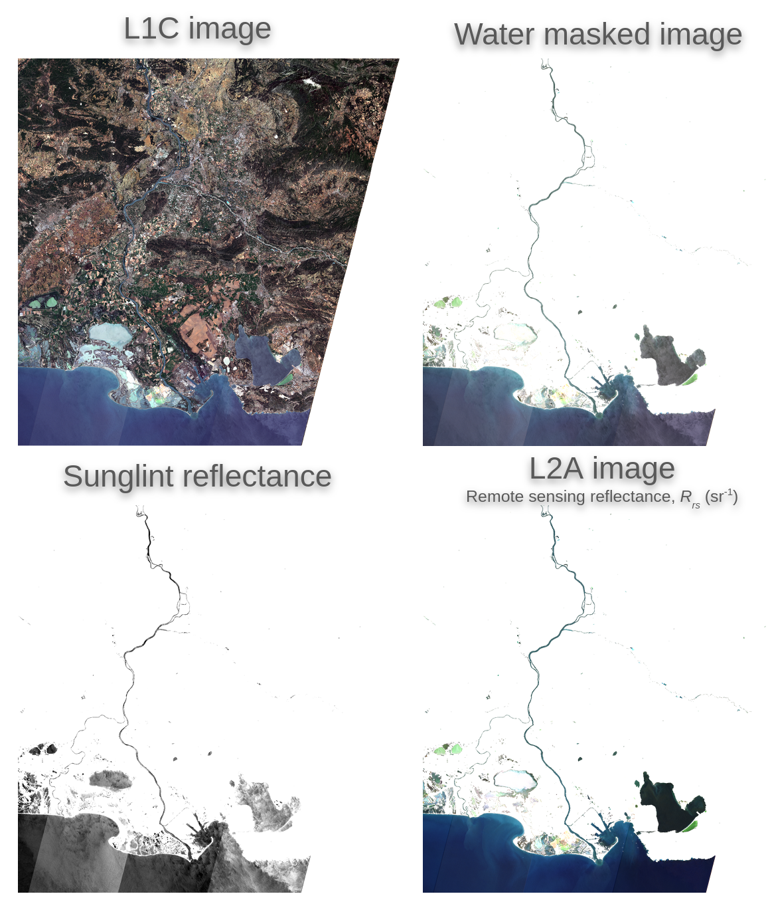

GRS documentation
=================

GRS (Glint Removal for Sentinel-2-like sensors)
-----------------------------------------------

The GRS algorithm (`Harmel et al., 2018
<https://www.sciencedirect.com/science/article/pii/S0034425717304856>`__) corrects high-spatial
resolution multispectral images (Sentinel-2, Landsat 8/9) acquired over water for the atmosphere and
for the sunlight reflected by the water surface (sunglint), which can reach the sensor of nadir or
near-nadir viewing missions with SWIR bands. The processor corrects successively for:

- the gaseous absorption,
- the diffuse light of the sky and its reflection by the air-water interface,
- the sunglint, estimated in the SWIR bands,

to retrieve the remote-sensing reflectance :math:`R_{rs}` at the water surface.

.. code-block:: bash

   grs S2B_MSIL1C_20220731T103629_N0400_R008_T31TFJ_20220731T124834.SAFE \
       --cams_file cams_forecast_2022-07.nc --resolution 20

.. toctree::
   :maxdepth: 2
   :caption: User guide

   installation
   usage
   methods
   processing_chain

.. toctree::
   :maxdepth: 2
   :caption: Tutorials

   examples/basics
   examples/auxdata
   examples/batch
   examples/advanced
   examples/visualization

.. toctree::
   :maxdepth: 2
   :caption: Reference

   api
   history

.. toctree::
   :maxdepth: 1
   :caption: Funding

   support

Interactive data manipulation
-----------------------------

See the GRS toolbox package `grstbx <https://github.com/Tristanovsk/grstbx>`__.

.. only:: not latex

   .. figure:: _static/grstbx_visual_tool.gif
      :alt: animated dashboard of grstbx

.. only:: latex

   .. figure:: _static/grstbx_visual_tool.png
      :alt: dashboard of grstbx

Indices and tables
------------------

* :ref:`genindex`
* :ref:`modindex`
* :ref:`search`
